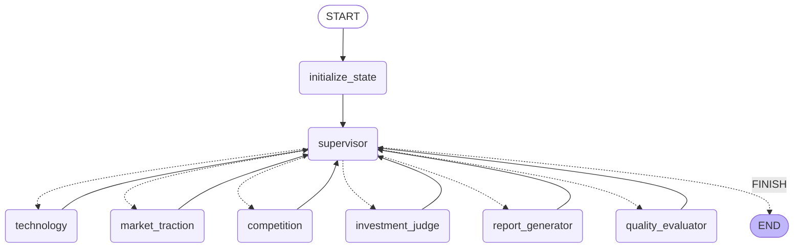

# AI Startup Investment Evaluation Agent
본 프로젝트는 General-purpose Humanoid Robotics 스타트업(Figure AI, Apptronik, 1X Technologies)의 투자 가능성을 기술·시장·경쟁 관점에서 평가하는 에이전트를 Supervisor 패턴 기반으로 설계/개발한 프로젝트입니다.


## Overview
- Objective : 휴머노이드 스타트업을 기술·제품 성숙도, 시장·고객 Traction, 경쟁 차별성, 제조·배치 확장성 관점에서 평가하고 근거가 연결된 투자 보고서 생성
- Pattern : Supervisor - 근거가 부족한 문항이 기업마다 다르게 나오므로, 결과를 보고 필요한 Agent만 다시 부르는 구조가 필요함. 분석 → 비교 → 평가 사이에 순서 의존성이 있어 한 번에 병렬로 나누는 방식보다 매 단계 State를 보고 다음 담당을 정하는 방식이 적합함
- 동적 처리 : 고정 순서 대신 Supervisor가 매 단계 State를 읽어 다음 Agent를 정함
  - 근거 충분성 : 평가 가능 문항이 9개 미만인 기업은 N/A 문항을 맡은 분석 Agent에만 재작업 요청 → 비교 갱신 → 해당 기업만 재평가
  - 보고서 품질 : 평가 미달 시 지적 내용에 따라 분석 Agent 재작업 또는 보고서 재작성으로 분기
  - 보고서 작성 시점은 단계 수가 아니라 근거 충분성 판단으로 결정 (실행마다 단계 수가 달라짐)
  - 근거 충분성과 보고서 품질의 판정은 Investment Judge와 Quality Evaluator(LLM + Python 검증)가 하고, Supervisor는 그 결과가 담긴 State로 분기만 결정 (판정은 확률적, 분기는 결정론적)


## Evaluation Targets
- Figure AI : 산업용 (자동차 제조·물류 공정), 가정용 확장 준비
- Apptronik : 산업용 (제조·물류 현장 물품 이송, 반복 작업)
- 1X Technologies : 가정용 (가사 보조·일상 지원)
- 평가 기준 : Bessemer Checklist 10문항 + 휴머노이드 특화 2문항 (Q1~Q12)


## Features
- PDF 자료 기반 정보 추출 : 기업 자료 15개 + 공통 시장 보고서 7개 (113쪽), 페이지·청크 단위 출처 추적
- Agentic RAG : 하위 질문 검색 → 근거 충분성 점검 → 부족 질문만 재검색 → 근거 대조
- Supervisor 재작업 요청 : 근거 부족 문항 또는 품질 평가 지적을 담당 Agent에 전달
- LLM이 아닌 Python 규칙으로 점수 검증·투자 판정·라우팅 수행 (INVEST / HOLD / HOLD_INSUFFICIENT_EVIDENCE)
- 확증 편향 방지 전략 :
  - 기업 주장 ≠ 달성 성과, Demo ≠ 상용 배치, 근거 없음 ≠ 부정 근거
  - 기업 자체 자료는 Evidence Level 상한(E2) 적용, 5점은 외부 검증 근거(E3 이상)가 있어야 부여
  - 시장 근거와 기업 근거를 분리 검색하고, 현재 평가 기업의 자료만 사용
  - 근거가 없는 문항은 추정하지 않고 N/A 처리, 부족 정보를 보고서에 명시
- 보고서 품질 평가 : 보고서 생성 후 3개 항목을 Hybrid 방식(규칙 검사 + LLM Judge)으로 평가하고, 미달 시 재작업·재작성 Loop
  - Groundedness : 수치·분석 문장의 인용 여부, 인용 ID와 REFERENCE·원문 청크의 연결을 규칙으로 검사하고, 문장이 원문 범위를 넘는지 Judge가 판단
  - 중립성 : 기술 우열·채택 추천 결론이 없는지, 사실·해석·전망이 구분되는지 Judge가 판단
  - 편향 통제 : 기업 홍보자료 의존, 유리한 근거 편중, 위험 근거 누락을 Judge가 판단
  - 미달 문장마다 출처 분석(담당)과 사유를 반환. Supervisor가 분석 근거 문제는 해당 Agent 재작업, 서술 문제는 보고서 재작성으로 분기
  - 점수표·판정 사유처럼 Python 규칙이 계산한 문장은 인용 검사 대상에서 제외하고, 재작성 때도 지우지 않음
- LangSmith 트레이싱 : Supervisor의 결정과 사유를 단계별로 기록


## Tech Stack
| Category | Details |
|---|---|
| Framework | LangGraph, LangChain, Python 3.11 |
| LLM/Generator | gpt-4o-mini (OpenAI API, temperature 0, seed 42) |
| LLM/Judge | gpt-4o-mini (구조화 출력 + Python 검증) |
| Retrieval | Chroma - Hit Rate@5 0.906, MRR@5 0.667 (문서 기반 질문 64개, Agent별 검색 범위 적용, 한국어 질의 자동 번역) |
| Embedding | intfloat/multilingual-e5-base |
| Report | reportlab (PDF) |
| Tracing | LangSmith |


## Agents
- Supervisor : State를 읽어 다음에 부를 Agent 하나를 결정. 근거 충분성 평가, 재작업 요청, 실패 재시도·제외, 종료 판단을 담당. LLM을 쓰지 않는 규칙 기반 판단이라 같은 State면 같은 결정을 냄
- Technology & Product Agent : 기업 기술자료를 검색해 제품·AI·자율성·신뢰성·안전 등 기술 성숙도 분석. 인용문을 원문과 대조해 검증된 근거만 전달하고, 재작업 요청 시 부족 문항에 해당하는 질문만 재검색해 기존 결과와 병합
- Market & Traction Agent : 공통 시장 보고서와 기업 자료를 나눠 검색해 시장 규모, 고객 배치·계약, 사업모델, 팀, 제조·Fleet 운영 분석. 재작업 요청의 부족 문항과 품질 지적을 반영해 재분석
- Competition Agent : 모든 후보의 분석 결과를 비교해 Target Market 맥락, 차별성, 상대 Risk 정리. 분석 결과에 실제로 있는 근거만 비교의 출처로 인정
- Investment Judge Agent : 분석 근거로 12개 문항을 채점하고, Python 규칙으로 최종 점수와 투자 판정 확정
- Report Generator Agent : 확정된 결과로 SUMMARY, 기술·시장 분석, 경쟁 비교·점수표, REFERENCE를 담은 PDF 보고서(최대 10쪽)와 같은 본문의 Markdown 생성. 재작성 시 품질 평가 지적을 반영
- Report Quality Evaluator : 보고서의 Groundedness·중립성·편향 통제를 규칙 검사와 LLM Judge로 평가하고 미달 문장·출처·이유를 반환. 통과 여부는 Python 규칙으로 계산

하위 Agent는 Supervisor하고만 연결됩니다. 하위 Agent는 자기 결과만 State에 기록하고 Supervisor로 돌아오며, 재작업 여부와 대상은 Supervisor가 정합니다.

### 평가 기준 (Q1~Q12)
| 구분 | 문항 |
|---|---|
| Bessemer Checklist | Q1 Market Size · Q2 Problem/Product Fit · Q3 Willingness to Pay · Q4 Differentiation · Q5 Team · Q6 Early Customer Response · Q7 Business Model · Q8 Upside Potential · Q9 Risk · Q10 Founder Commitment |
| 휴머노이드 특화 | Q11 Technology Maturity · Q12 Manufacturing & Deployment |

- 점수 : 1·3·5점 (5점은 외부 검증 근거 E3 이상 필요), 판단 불가 시 N/A
- 판정 : 평가 가능 문항 9개 미만 → HOLD_INSUFFICIENT_EVIDENCE / 평균 3.2 이상 → INVEST / 미만 → HOLD

### 품질 평가 항목의 적용 범위
- 본 프로젝트의 주제는 기술 비교가 아니라 스타트업 투자 평가이므로, 과제의 최소 평가 항목 4개 중 주제에 해당하는 3개(Groundedness, 중립성, 편향 통제)를 적용함. "관점 커버리지"(기술 성숙도·시장성·이해관계자·도메인 적용)는 기술 평가 주제의 항목이라 제외
- 중립성은 주제에 맞게 해석함. INVEST/HOLD 판정은 12문항 점수에 Python 규칙을 적용한 계산 결과이므로 허용하고, 품질 평가는 그 판정이 규칙·점수와 일치하는지와 근거 없는 기술 우열·추천 서술이 없는지를 검사함. 보고서에도 "판정은 기업 간 우열을 뜻하지 않는다"고 명시


## State Schema
State는 "작업 페이로드"와 "제어 메타데이터"로 나눠 `core/state.py`에 정의했습니다.

- 제어 vs 페이로드 분리 : 분석·비교·평가 결과와 보고서는 페이로드, 라우팅(`next`, `current_company`, `rework_request`)·작업 추적(`pending_judge`, `rework_counts`, `report_attempts`)·종료(`step_count`, `max_steps`, `status`)는 제어 메타데이터로 구분. 제어 필드는 Supervisor만 쓰고 하위 Agent는 자기 결과 필드만 씀
- 관측성 위치 : 결정 로그(사유 포함)는 State에 쌓지 않고 외부로 분리. Supervisor가 결정마다 `{trace_id, ts, step, next, company, reason}`을 logger와 LangSmith(`supervisor_decision`)에 기록. State에는 현재 결정(`next`)만 남김. 품질 평가의 회차별 지적은 실행 종료 시 Checkpoint 이력에서 꺼내 `outputs/quality_*.json`으로 저장
- 지속성 비용 : 분석 결과는 기업명을 Key로 덮어쓰므로 재작업해도 늘어나지 않음. 누적되는 필드는 실패 시에만 한 건씩 추가되는 `errors`뿐. PDF 본문은 파일로 저장하고 State에는 경로(`report_path`)만 둠
- 상관 : `trace_id` 하나를 State, 로그, LangSmith 메타데이터, Checkpoint의 `thread_id`에 동일하게 사용
- 재개/복구 : 노드·기업 단위 마지막 상태(`node_status`)와 오류(`errors`, `last_error`)를 기록. 하위 Agent의 예외는 State에 남기고 Supervisor로 복귀하며, Supervisor가 재시도 1회 → 제외(빈 결과) 또는 중단을 결정. 다음 할 일은 State만으로 다시 계산되므로 Checkpoint에서 이어서 실행 가능 (테스트로 검증). 현재는 메모리 Checkpoint라 같은 프로세스 안에서만 재개되며, 영속 저장소로 바꾸면 프로세스 종료 후에도 재개 가능
- 동시 처리 : Supervisor가 한 번에 한 Agent만 호출하므로 동시 쓰기가 없음. 기업별 결과와 `node_status`는 병합 Reducer(`merge_dict`), `errors`는 `operator.add`로 선언해 서로 덮어쓰지 않도록 함
- 종료 보장 : 반복 상한을 세 겹으로 관리. Agent별 재작업 1회(`rework_counts`), 보고서 작성 2회(`report_attempts`), 전체 호출 수(`step_count` ≤ `max_steps`). 상한은 보고서 작성 시점을 정하는 값이 아니라 끝나지 않는 Loop에서 빠져나오기 위한 장치이며, 재작업 요청 전에 보고서까지 마칠 단계가 남았는지 먼저 확인함


## Architecture


- 점선은 `add_conditional_edges`로 연결한 동적 분기, 실선은 작업 후 Supervisor로의 복귀
- Supervisor의 판단 순서 : 분석이 없는 기업·관점 → 근거 부족·품질 미달에 따른 재작업 → 비교(없거나 분석이 바뀐 경우) → 평가가 필요한 기업 → 보고서 → 품질 평가 → 종료
- 실행 예 (기업 3개, 24단계, trace_id `0d57fd3d42f64c74ac01f643757307d8`)
  - 1~10 : 분석 6 → 비교 1 → 평가 3
  - 11~17 : 근거 부족 기업(Apptronik 8/12, 1X 7/12)의 Technology·Market 재작업 4 → 비교 1 → 재평가 2 (Apptronik 12/12로 회복, 1X는 7/12 유지)
  - 18~19 : 보고서 1차 (사유: 근거 부족 기업의 재작업 상한 도달 → 남은 문항 N/A 확정) → 품질 평가 미달
  - 20~22 : 품질 지적 문장의 출처인 Figure AI의 Market 재작업 1 → 비교 1 → 재평가 1
  - 23~24 : 보고서 2차 → 품질 평가 미달, 재작성 상한 도달로 종료
- 근거가 처음부터 충분한 실행은 재작업 없이 14단계에서 끝남 (전체 호출 상한 28)


## Directory Structure
```
├── data/                  # 문서 풀 (manifest.csv, 기업 자료, 시장 보고서, company_profiles.json)
├── agents/                # Agent 모듈
│   ├── supervisor.py      #   조정 계층 (판단, 근거 충분성 평가, 라우팅 Gate)
│   ├── technology.py, market_traction.py, competition.py
│   ├── investment_judge.py, report_generator.py
│   └── quality_evaluator.py
├── prompts/               # 프롬프트 템플릿 (common.py: 전체 공통 근거·인용 규칙)
├── evaluation/            # 12문항 평가 기준·투자 판정 규칙, 보고서 품질 평가 (규칙 검사, Judge 검증)
├── rag/                   # 인덱싱, 검색, 임베딩, 검색 성능 평가
├── documents/             # PDF 로딩·정리, 메타데이터, 문서 구성 점검
├── core/                  # LangGraph 그래프, State, LLM, 트레이싱 설정
├── assets/                # PDF 보고서용 한글 폰트 (NanumGothic)
├── tests/                 # 단위 테스트
├── outputs/               # 실행 결과 (Markdown 보고서, 실행 기록 state_*.json, 품질 평가 지적 quality_*.json)
├── reports/               # 실행 결과 (PDF 투자 보고서)
├── app.py                 # 실행 스크립트
└── README.md
```


## Usage
[uv](https://docs.astral.sh/uv/)를 설치한 뒤, 프로젝트 폴더에 `.env` 파일을 만들고 아래 값을 입력합니다.
```
OPENAI_API_KEY=발급받은_키
LANGCHAIN_TRACING_V2=false          # LangSmith를 쓰려면 true + LANGCHAIN_API_KEY 입력
LANGCHAIN_API_KEY=
HF_TOKEN=                           # 선택: 임베딩 모델 다운로드 속도 제한 완화
```

```bash
uv sync                              # 패키지 설치
uv run python -m rag.build_index     # 벡터DB 생성 (최초 1회 또는 문서 변경 시)
uv run python app.py                 # 전체 실행 → reports/investment_report.pdf
```

- 일부 기업만 평가 : `uv run python app.py --companies "Apptronik"`
- 단위 테스트 : `uv run python -m unittest discover -s tests`
- 실행이 끝나면 판정 결과와 함께 `trace_id`, 단계 수, 재작업 내역, 품질 평가 결과를 출력하고, 실행 기록을 `outputs/`에 저장합니다.

### 한계
- LLM 비결정성 : temperature 0, seed 42를 써도 OpenAI 응답이 완전히 같지는 않아, 실행마다 점수·판정·단계 수가 달라질 수 있음. 1·3·5점 척도와 기준 3.2 근처에 점수가 모여 있어 문항 하나의 차이로 판정이 바뀔 수 있음. Supervisor의 분기 규칙과 반복 상한은 LLM을 쓰지 않아 실행마다 같음
- 문서 풀의 한계 : 팀·창업자 관련 문서와 외부 검증 자료가 부족해 Q5·Q10이 N/A가 되기 쉽고, 품질 평가가 "외부 검증 부족"을 지적해도 재작업으로 해소되지 않아 미달로 끝날 수 있음
- Checkpoint는 메모리 방식이라 프로세스가 끝나면 사라짐


## Contributors
- 김규빈 : Supervisor 설계·구현 (State 기반 라우팅, 근거 충분성 평가, 재작업·재시도·종료 상한), LangGraph 그래프, State Schema, 실행 기록 저장
- 박진근 : Technology & Product Agent (기술 RAG, 원문 인용 검증, 부족 문항별 재검색·결과 병합)
- 강지훈 : Market & Traction Agent의 재작업 대응, Competition Agent (근거 검증, 비교 축별 평가 문항 연결)
- 윤서진 : Report Generator (보고서 구성·PDF 생성, 인용 연결, 품질 지적 반영 재작성)
- 정지우 : Report Quality Evaluator (Hybrid 품질 평가: 규칙 검사 + LLM Judge, 원문 조회, 평가 테스트)
